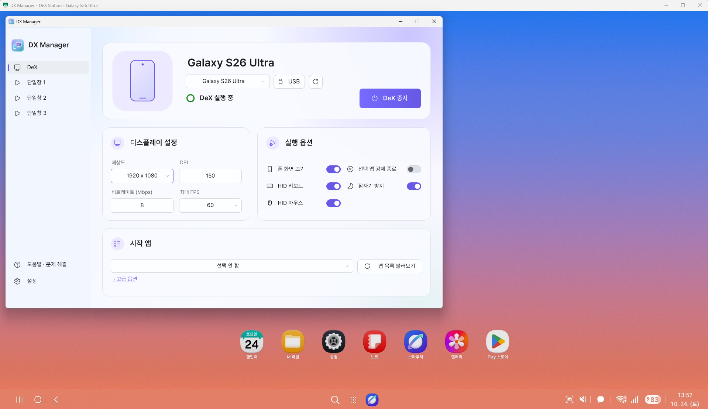
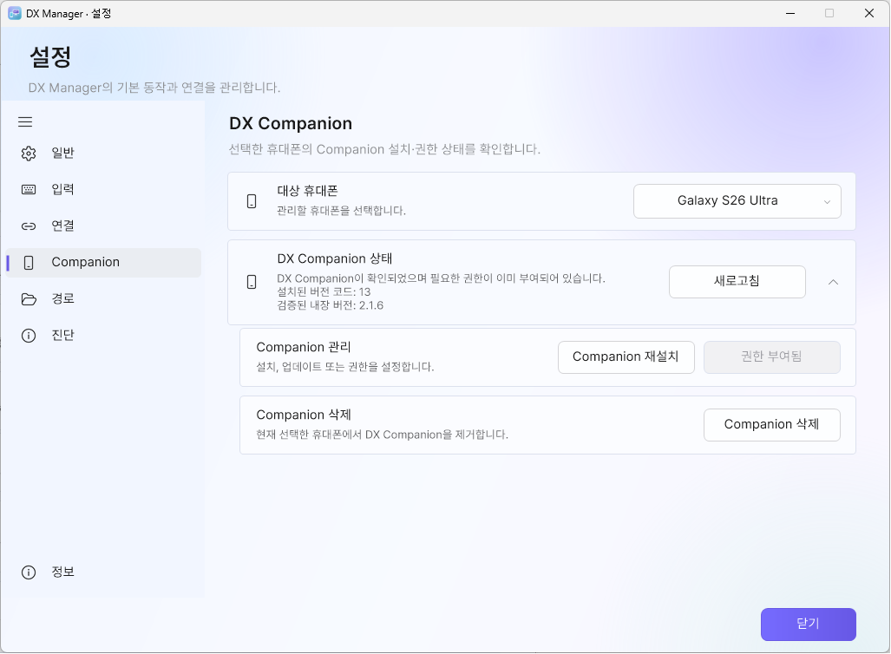

<h1 align="center">DX Manager</h1>

Samsung DeX and independent Android app windows on your computer.

컴퓨터에서 Samsung DeX와 앱별 단일창을 관리합니다.

<a href="#english">English</a> · <a href="#korean">한국어</a> ·
<a href="https://github.com/maze-mei/DX-Manager/releases/latest">Releases</a> ·
<a href="docs/USER_GUIDE_EN.md">User guide</a> · <a href="docs/USER_GUIDE_KO.md">사용 설명서</a> ·
<a href="docs/FAQ_EN.md">FAQ</a> · <a href="https://github.com/maze-mei/DX-Manager/blob/main/docs/MACOS_GUIDE.md">macOS</a>

## English

### What is DX Manager?

DX Manager is an independent utility built around [scrcpy](https://github.com/Genymobile/scrcpy)
and ADB. On Windows it manages a Samsung DeX virtual display and up to three additional single-app
windows for each connected Galaxy phone. Multiple phones keep independent sessions, settings and transfers.

It began as personal Batch/CMD and AutoHotkey tools and became a C# desktop application.
It is designed for everyday DeX use, including Windows 7 and PCs without Internet access.

<small>Actual Windows 2.5.0 capture with a Galaxy S26 Ultra. Single-window mode is also supported.</small>

### Windows 2.5.0

| Component | Version / requirement |
| --- | --- |
| DX Manager | 2.5.0, portable Windows x64 |
| Windows | 7 SP1, 8.1, 10 or 11; 32-bit Windows is not supported |
| Runtime | .NET Framework 4.6.2 or later |
| scrcpy | 5.0.1; automatic hardware-decoder selection |
| Optional DX Companion | Official 2.1.6, versionCode 13; Android 13 or later |

Samsung DeX support on the phone is required. Testing includes Android 16 / One UI 8.x;
the maintainer also confirmed Galaxy S26 Ultra / Android 17 / One UI 9 operation.
Older firmware may show a black DeX window; individual apps can restrict secondary displays.
See the [compatibility FAQ](docs/FAQ_EN.md#q18-the-dex-window-is-black-on-an-older-one-ui-version).

### Features

- **DeX and app windows:** DeX plus three individually configured single-window slots per phone.
- **Multiple phones:** separate sessions, app lists/profiles, connection settings and transfer queues.
- **USB and wireless:** USB, wireless prepared over USB, and six-digit Android wireless-debugging pairing.
  New launches prefer authorized USB when both transports exist; running windows keep their original transport.
- **Display settings:** resolution, DPI, bitrate, 30/60 FPS and experimental maximum 120 FPS. Default: 60 FPS.
- **Experimental 120 FPS:** confirmation before every start, phone screen kept on, and restoration of the
  previous screen-off preference at 30/60. Heat, battery and OLED burn-in warnings apply.
  Actual FPS depends on the device, app and activity.
- **Input and capture:** HID keyboard/mouse, optional corrections, Scroll Lock Enter/Shift+Enter switching,
  F8 capture and a mini control bar for each scrcpy window.
- **Files:** Unicode files/folders in both directions, preserved empty folders, collision-safe names
  and separate status windows.
- **Desktop UI:** English/Korean, light/dark, offline help, diagnostics and saved first-run consent.
  Running the EXE again restores the existing main window from the tray.
- **Updates:** one background GitHub check per local day, manual checks in Settings > About,
  and no repeated offline retry loop. Downloads and installation remain manual.

### Download, install and update

Use [the latest release page](https://github.com/maze-mei/DX-Manager/releases/latest)
or [download the latest Windows ZIP](https://github.com/maze-mei/DX-Manager/releases/latest/download/DX-Manager-win-x64.zip).

Starting with Windows 2.5.0, the ZIP name is fixed and the folder inside identifies the version:

~~~text
DX-Manager-win-x64.zip
└─ DX Manager v2.5.0/
   ├─ DXManager.exe
   ├─ config/
   ├─ tools/
   └─ ...
~~~

1. Extract the **whole folder** to a location your account can write to.
2. Run `DXManager.exe`. On first launch, read the notice, tick its acknowledgement box and confirm.
3. Enable Developer options and USB debugging on the phone. Connect it and approve the RSA prompt.
4. Choose the phone in the device selector, then select **DeX > Start DeX**.
   For **Window 1–3**, choose a start app before starting.
5. Keep the phone connected until **Stop DeX** or tray **Exit** finishes cleanup.

The main window's X hides it to the tray. Use tray **Exit** or **Left Alt+F8** for a full exit.
Windows 7 may need [.NET Framework 4.6.2](https://dotnet.microsoft.com/en-us/download/dotnet-framework/net462)
and the updates required by legacy ADB. Local USB/LAN operation needs no Internet after setup.

For an upgrade, exit the old copy and preserve your personal configuration as described in
[Updating an existing installation](docs/USER_GUIDE_EN.md#updating-an-existing-installation).
Do not replace only the EXE.

**Websites linking to Windows downloads:** use the fixed latest-Windows-ZIP link above.
The newest Windows release must contain exactly `DX-Manager-win-x64.zip`.
Links containing an older tag or versioned filename remain tied to that older file.
Third-party mirrors may lag; compare their version with the official release page.

### DX Companion

The optional Android app is included at `tools/companion/DX-Companion.apk` and is **not installed automatically**.
Open **Settings > Companion**, select the phone, then install/update it and grant cleanup permission.
DX Manager verifies the official APK identity, version, hash and certificate.
Existing users should update to **2.1.6** for the current recovery/notification behavior.

Companion provides recovery controls, a Quick Settings tile/widget and phone-to-PC sharing.
Session protection can start as soon as DX Manager connects, even before DeX runs.
After the PC link is lost, protection stops promptly if virtual-display and Stay awake settings are
verified clean. Remaining recovery work follows the configured disconnect policy.

See [Companion setup and transfers](docs/USER_GUIDE_EN.md#12-dx-companion-optional)
and the [notification FAQ](docs/FAQ_EN.md#q26-why-does-the-companion-session-protection-notification-remain).

### Updates, shortcuts and help

Automatic checks are silent when no update is available or the network is unavailable.
A new version appears in a **lower-right nonmodal banner**, or a Windows tray notification while hidden.
The banner stays until dismissed; its GitHub button opens the release page.
A cached notice can remain offline. Use **Settings > About > Check for updates** for a manual result.

Local **What's new** notes after an upgrade are separate from online checks and first-run safety consent.
They use no Internet. See the [update FAQ](docs/FAQ_EN.md#q25-how-do-update-checks-behave-without-internet).

| Action | Default shortcut |
| --- | --- |
| Start capture / capture the active scrcpy client | F8 / F8 again |
| Cancel capture | Esc |
| Exit DX Manager | Left Alt+F8 |
| Optional Enter ↔ Shift+Enter toggle | Scroll Lock, when enabled in Settings > Keyboard |
| scrcpy fullscreen / 1:1 window size | Alt+F or F11 / Alt+G |
| Phone screen off / on | Alt+O / Alt+Shift+O |

120 FPS requires the phone screen on; manually turning it off can reduce FPS.

- [User guide](docs/USER_GUIDE_EN.md) · [FAQ](docs/FAQ_EN.md)
- [2.5.0 changes](docs/RELEASE_NOTES_v2.5.0.md) · [Checksums and verification](docs/VERIFICATION_v2.5.0.md)
- [Report a problem](https://github.com/maze-mei/DX-Manager/issues): include the version and a redacted diagnostic report.

### macOS, source and licenses

The public repository also has a separate **.NET 8 macOS TUI/CLI implementation**, targeting macOS 14+
on Apple Silicon and Intel. Follow the [macOS guide](https://github.com/maze-mei/DX-Manager/blob/main/docs/MACOS_GUIDE.md)
for its own runtime/build status. The Windows 2.5.0 ZIP is not a Mac application.
At the 2026-10-24 documentation review, published releases contained Windows assets and no published Mac ZIP.
Windows 2.5.0 features/test counts do not describe macOS validation.

Windows source includes the matching [official Companion source and signed APK](companion/README.md).
The canonical shared component remains the single development source; public checkouts use the included release snapshot.
See [Building](docs/BUILDING.md).
DX Manager is [MIT licensed](LICENSE); scrcpy, libraries, fonts and Fluent icons retain their own
licenses in [third-party notices](DexManager/licenses/THIRD_PARTY_NOTICES.md).
Developed independently by [maze](https://github.com/maze-mei), without affiliation, sponsorship or
endorsement by Samsung Electronics or Genymobile. Samsung and Samsung DeX are Samsung trademarks.

---

## 한국어

### DX Manager는 어떤 프로그램인가요?

DX Manager는 [scrcpy](https://github.com/Genymobile/scrcpy)와 ADB를 사용하는 독립 개발 도구입니다.
Windows에서 Galaxy 휴대폰마다 Samsung DeX 가상 화면과 최대 세 개의 앱별 단일창을 관리합니다.
여러 휴대폰에서의 실행 세션·설정·파일 전송은 서로 분리됩니다.

개인용 Batch/CMD·AutoHotkey 도구에서 시작해 C# 데스크톱 앱으로 발전했으며,
Windows 7이나 인터넷이 없는 PC에서도 일상적으로 DeX를 사용할 수 있게 만드는 것이 목적입니다.

<small>Galaxy S26 Ultra로 촬영한 Windows 2.5.0 화면입니다. 앱별 단일창도 지원합니다.</small>

### Windows 2.5.0 구성

| 항목 | 버전 / 조건 |
| --- | --- |
| DX Manager | 2.5.0, Windows x64 포터블 |
| Windows | 7 SP1·8.1·10·11, 32비트 미지원 |
| 실행 환경 | .NET Framework 4.6.2 이상 |
| scrcpy | 5.0.1, 하드웨어 디코더 자동 선택 |
| 선택형 DX Companion | 정식 2.1.6, 버전 코드 13, Android 13 이상 |

휴대폰에서 Samsung DeX 지원이 필요합니다. Android 16 / One UI 8.x를 기준으로 확인했으며,
개발자가 Galaxy S26 Ultra / Android 17 / One UI 9에서 동작을 확인했습니다.
이전 펌웨어에서는 DeX가 검게 표시될 수 있고 앱별 다중 화면 제한도 있습니다.
[호환성 FAQ](docs/FAQ_KO.md#q18-이전-one-ui-버전에서-dex-창이-검게-표시됩니다)를 확인하세요.

### 주요 기능

- **DeX·단일창:** 휴대폰마다 DeX와 별도 설정을 가진 단일창 세 슬롯을 실행합니다.
- **여러 휴대폰:** 실행 세션·앱 목록·프로필·연결 설정·전송 대기열을 기기별로 관리합니다.
- **USB·무선:** USB, USB로 준비한 무선 ADB, 6자리 코드 무선 디버깅 페어링을 지원합니다.
  새 실행은 승인된 USB가 있으면 우선 사용하고, 실행 중인 창의 연결 방식은 유지합니다.
- **화면 설정:** 해상도·DPI·비트레이트, 30/60 FPS와 실험적 최대 120 FPS를 선택합니다. 기본값은 60 FPS입니다.
- **120 FPS 실험적 모드:** 실제 실행마다 경고를 확인해야하고 휴대폰 화면을 켜둡니다.
  30/60으로 돌아오면 이전 화면 끄기 값을 복원합니다. 발열·배터리·OLED 번인에 주의해야 하며 실제 FPS는 기기·앱·입력 상태에 따라 달라집니다.
- **입력·캡처:** HID 키보드/마우스, 키 입력 보정, Scroll Lock Enter/Shift+Enter 전환, F8 캡처, 창별 미니바를 제공합니다.
- **파일:** Unicode형식의 파일/폴더를 양방향 전송하고 빈 폴더·폴더 구조를 보존하며 같은 이름은 번호를 붙입니다.
- **화면 구성:** 한국어와 영어지원, 밝음·다크, 오프라인 도움말, 진단과 첫 실행 동의를 제공합니다. 프로그램 실행중 실행파일을 다시 실행하면 트레이의 기존 메인창을 엽니다.
- **업데이트 안내:** 하루 한 번 백그라운드에서 확인하고 정보 메뉴에서 직접 확인할 수 있습니다. 인터넷이 연결되지 않으면 재시도를 반복하지 않으며 다운로드·설치는 직접 진행합니다.

### 다운로드·설치·업데이트

[최신 릴리스 페이지](https://github.com/maze-mei/DX-Manager/releases/latest) 또는
[최신 Windows ZIP](https://github.com/maze-mei/DX-Manager/releases/latest/download/DX-Manager-win-x64.zip)을 사용하세요.

Windows 2.5.0부터 ZIP 이름은 고정하고 내부 폴더 이름으로 버전을 구분합니다.

~~~text
DX-Manager-win-x64.zip
└─ DX Manager v2.5.0/
   ├─ DXManager.exe
   ├─ config/
   ├─ tools/
   └─ ...
~~~

1. 쓰기 가능한 위치에 **폴더 전체**를 풀고 `DXManager.exe`와 주변 파일을 함께 둡니다.
2. 첫 실행 안내를 읽고 확인란을 선택해 동의합니다.
3. 휴대폰의 개발자 옵션·USB 디버깅을 켜고 USB 연결 후 디버깅을 승인합니다.
4. 기기 선택기에서 휴대폰을 고른 뒤 **DeX 시작**을 누릅니다. 단일창은 먼저 시작 앱을 선택하세요.
5. **DeX 중지**나 트레이 **종료**의 정리가 끝날 때까지 휴대폰 연결을 유지합니다.

메인창의 X는 트레이로 숨김입니다. 완전 종료는 트레이 **종료** 또는 **왼쪽 Alt+F8**을 사용하세요.
Windows 7은 [.NET Framework 4.6.2](https://dotnet.microsoft.com/en-us/download/dotnet-framework/net462)와
레거시 ADB에 필요한 업데이트가 필요할 수 있습니다. 준비 후 USB·로컬 LAN 사용에는 인터넷이 필요하지 않습니다.

업데이트는 기존 프로그램을 완전히 종료한 뒤 새 버전 폴더를 풀고,
[기존 설치 업데이트 안내](docs/USER_GUIDE_KO.md#기존-설치에서-업데이트)를 따라 개인 설정을 옮기세요.
EXE만 교체하지 마세요.

**외부 사이트에서 다운로드를 연결할 때:** 위 최신 Windows ZIP 주소를 사용하세요.
최신 Windows 릴리스에 정확히 같은 이름의 파일이 있어야 합니다.
예전 태그·파일명을 넣은 링크는 그 예전 파일에 고정되며 외부 미러는 갱신이 늦을 수 있습니다.
공식 릴리스의 버전과 비교해서 확인하세요.

### DX Companion

선택형 Android 앱은 `tools/companion/DX-Companion.apk`에 포함되며 **자동 설치하지 않습니다**.
**설정 > Companion**에서 대상 휴대폰을 선택해 설치·업데이트와 정리 권한 부여를 진행합니다.
정식 APK의 패키지·버전·해시·서명을 검증합니다. 기존 사용자는 현재 복구·알림 동작을 위해 **2.1.6**으로 업데이트하세요.

복구 버튼, 빠른 설정 타일·위젯과 휴대폰→PC 공유를 제공합니다.
PC에서 휴대폰을 인식하면 DeX 실행 전에도 세션 보호 알림이 나올 수 있습니다.
PC 연결이 끊기고 가상 화면·잠자기 방지가 정리됐음을 확인하면 감시를 중단하며,
복구할 항목이 남아 있으면 설정된 연결 해제 정책을 유지합니다.

[Companion 설치·전송 설명](docs/USER_GUIDE_KO.md#12-선택형-dx-companion)과
[알림 FAQ](docs/FAQ_KO.md#q26-companion의-세션-보호-알림이-남아-있습니다)를 확인하세요.

### 업데이트·단축키·도움말

자동 확인에서 새 버전이 없거나 오프라인이면 안내창을 띄우지 않습니다.
새 버전이 있으면 메인 **오른쪽 아래 배너**, 트레이 상태이면 Windows 알림으로 안내합니다.
배너는 직접 닫을 때까지 유지되며 GitHub 버튼으로 릴리스 페이지를 엽니다.
캐시된 새 버전 안내는 오프라인에서도 남을 수 있습니다. 직접 확인은 **설정 > 정보 > 업데이트 확인**입니다.

업데이트 후의 로컬 **변경사항 안내**는 온라인 확인·첫 실행 안전 동의와 별개이며 인터넷을 쓰지 않습니다.
[업데이트 FAQ](docs/FAQ_KO.md#q25-인터넷이-없을-때-업데이트-확인은-어떻게-동작하나요)에서 자세히 설명합니다.

| 동작 | 기본 단축키 |
| --- | --- |
| 캡처 시작 / 활성 scrcpy 창 캡처 | F8 / F8 다시 누름 |
| 캡처 취소 | Esc |
| DX Manager 완전 종료 | 왼쪽 Alt+F8 |
| 선택형 Enter ↔ Shift+Enter 전환 | 설정 > 입력에서 켠 뒤 Scroll Lock |
| scrcpy 전체 화면 / 1:1 창 크기 | Alt+F 또는 F11 / Alt+G |
| 휴대폰 화면 끄기 / 켜기 | Alt+O / Alt+Shift+O |

120 FPS에서는 휴대폰 화면을 켜두어야 하며 직접 끄면 FPS가 낮아질 수 있습니다.

- [사용 설명서](docs/USER_GUIDE_KO.md) · [자주 묻는 질문](docs/FAQ_KO.md)
- [2.5.0 변경사항](docs/RELEASE_NOTES_v2.5.0.md) · [해시·검증 범위](docs/VERIFICATION_v2.5.0.md)
- [문제 제보](https://github.com/maze-mei/DX-Manager/issues): 버전과 개인정보를 가린 진단 보고서를 함께 남겨주세요.

### macOS·소스·라이선스

공개 저장소에는 macOS 14 이상, Apple Silicon·Intel을 대상으로 한 별도의 **.NET 8 TUI/CLI 구현**도 있습니다.
그 버전·실행 환경·빌드 상태는 [macOS 가이드](https://github.com/maze-mei/DX-Manager/blob/main/docs/MACOS_GUIDE.md)를 따릅니다.
Windows 2.5.0 ZIP은 Mac 프로그램이 아닙니다. 2026-10-24 문서 확인 시 공개 릴리스에는 Windows 파일만 있었으며
공개된 Mac ZIP은 확인되지 않았습니다. Windows 기능·테스트 수를 macOS 검증 결과로 적용하지 않습니다.

공개 저장소에는 해당 버전의 [정식 Companion 소스와 서명 APK](companion/README.md)도 포함합니다.
개발 원본은 공용 폴더 한곳에서 유지하며 공개 소스 빌드는 동봉 릴리스 스냅샷을 사용합니다.
[빌드 안내](docs/BUILDING.md)를 확인하세요.
DX Manager는 [MIT 라이선스](LICENSE)이며 scrcpy·라이브러리·폰트·Fluent 아이콘의 라이선스는
[제3자 안내](DexManager/licenses/THIRD_PARTY_NOTICES.md)에 보존합니다.
[maze](https://github.com/maze-mei)가 독립 개발하며 삼성전자·Genymobile과 제휴·후원·보증 관계가 없습니다.
Samsung과 Samsung DeX는 삼성전자의 상표입니다.
