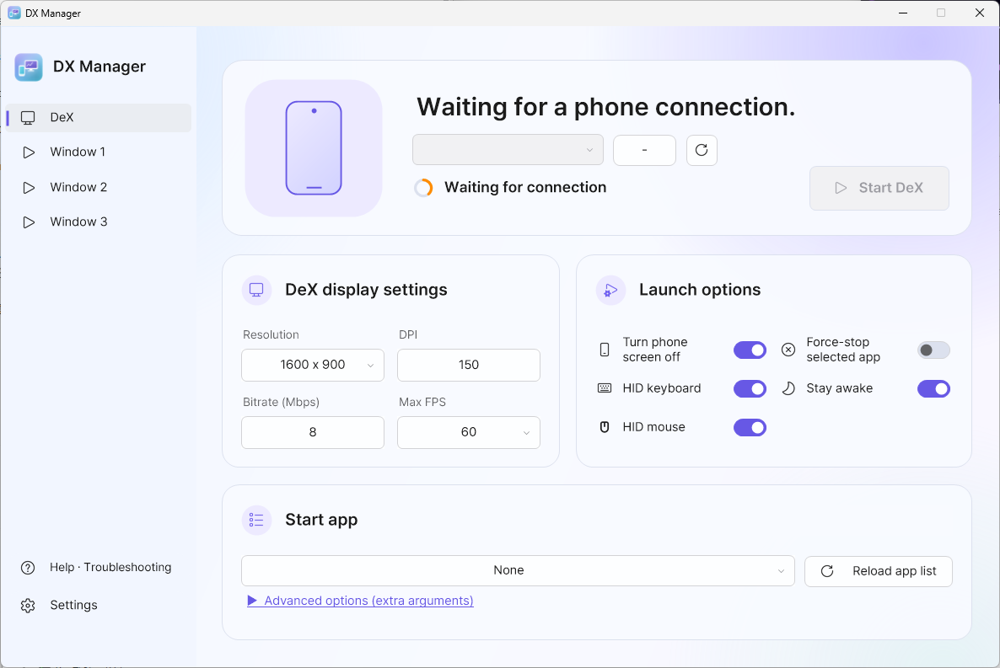
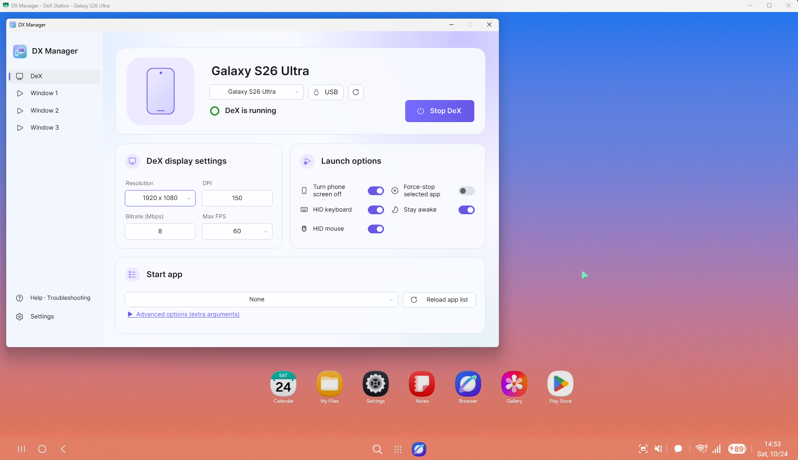
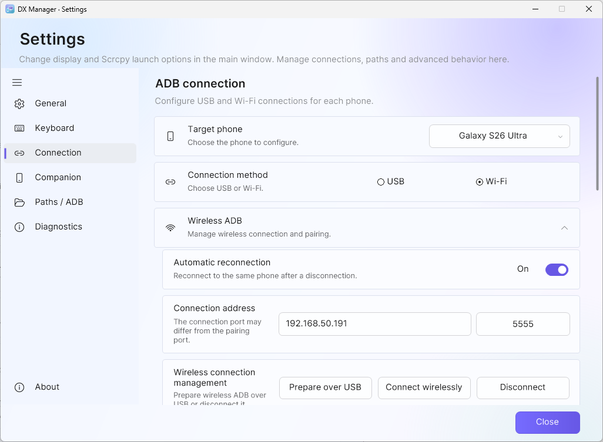
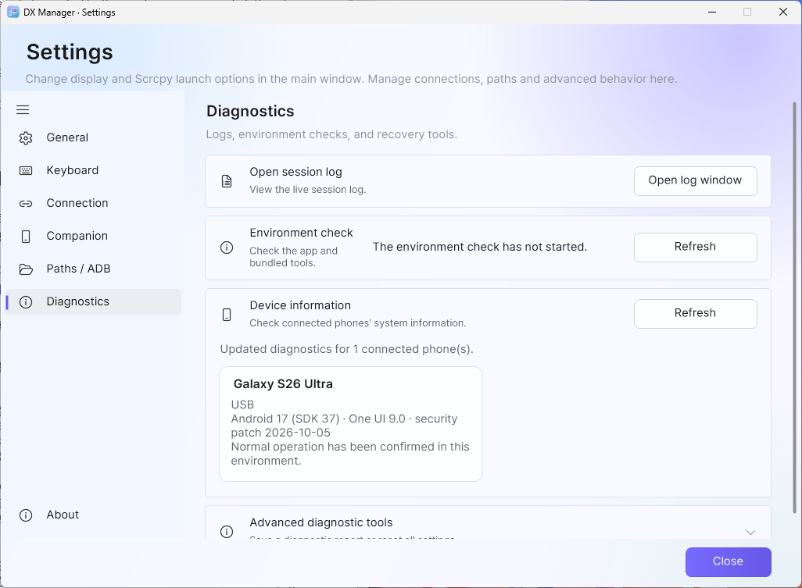
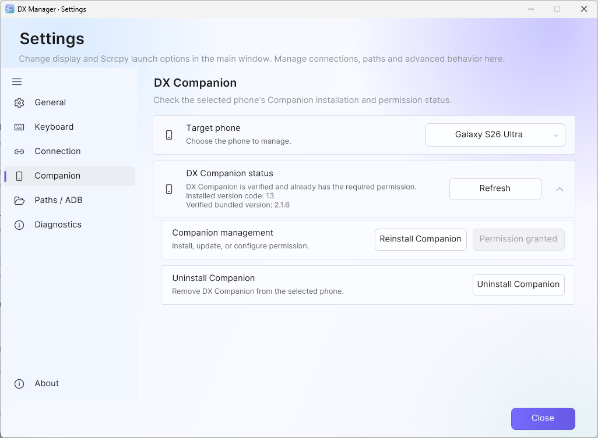
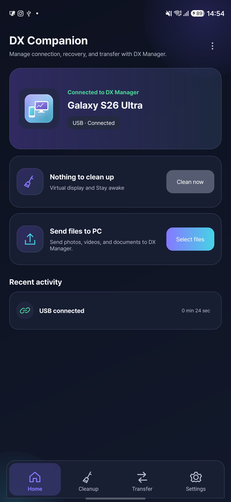
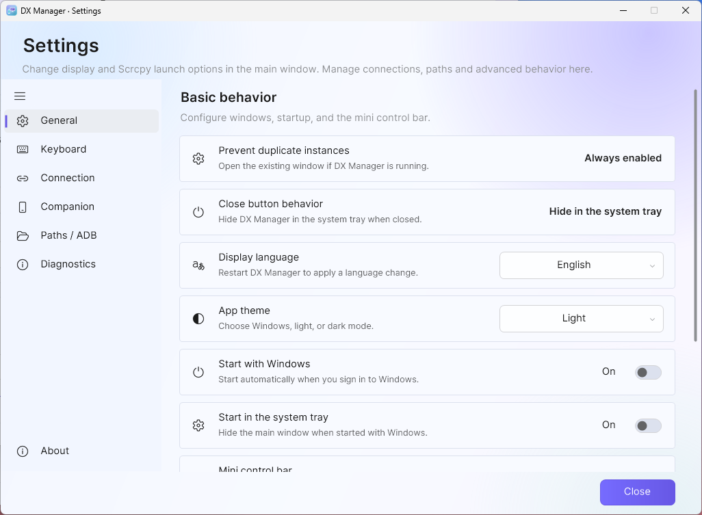
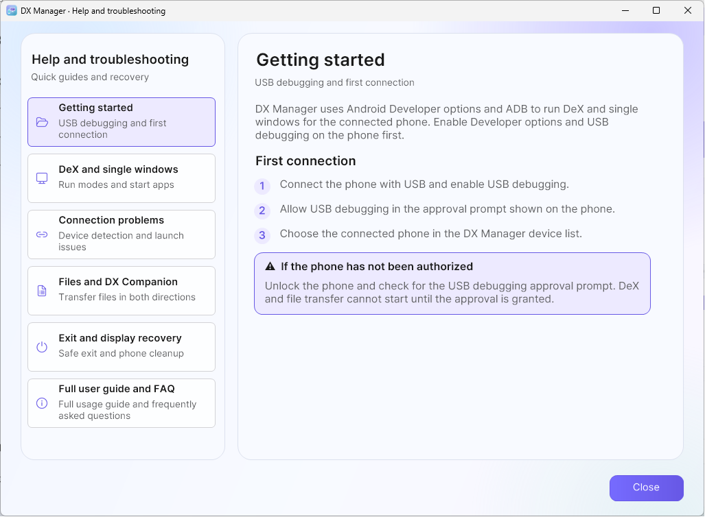

# DX Manager 2.5.0 User Guide

Documentation for DX Manager 2.5.0 on Windows, reviewed 2026-10-24. [Overview](../README.md) · [FAQ](FAQ_EN.md) · [Korean guide](USER_GUIDE_KO.md)

## 1. Requirements

### PC

- 64-bit Windows 7 SP1, 8.1, 10, or 11 (32-bit Windows is not supported)
- .NET Framework 4.6.2 or later
- Windows 7/8.1: Universal CRT updates required by the bundled legacy ADB
- Enough disk space to extract the complete release archive
- A user-writable extraction folder; DX Manager stores config, logs, and
  screenshots beside the executable

DX Manager intentionally targets .NET Framework 4.6.2 as its minimum runtime
to support Windows 7 SP1 and offline or closed-network PCs. Windows 7 SP1 does
not include 4.6.2 by default. If it is missing, download the runtime from the
[official Microsoft .NET Framework 4.6.2 page](https://dotnet.microsoft.com/en-us/download/dotnet-framework/net462).
For an offline PC, download the offline installer on another computer and
transfer it before setup. If .NET Framework 4.7.2 or 4.8 is already installed,
do not downgrade it or install 4.6.2 separately; later .NET Framework 4.x
versions satisfy this requirement.

### Phone

- A Samsung Galaxy device that supports Samsung DeX
- Developer options enabled
- USB debugging enabled
- A data-capable USB cable

The DeX baseline includes Android 16/One UI 8.x; the maintainer also reported Galaxy S26 Ultra / Android 17 / One UI 9 operation. One UI
7.x and earlier have not been confirmed to work reliably and may show a black
DeX window. Samsung firmware and device-specific behavior may still differ.

Approve the RSA debugging prompt shown on the phone during the first
connection. You may select **Always allow from this computer** on a trusted
PC.

  

<small>Android system-dialog example; layout and wording vary with the phone and firmware.</small>

## 2. Installation and First Run

1. Download `DX-Manager-win-x64.zip` from the [latest release page](https://github.com/maze-mei/DX-Manager/releases/latest) or [latest Windows ZIP](https://github.com/maze-mei/DX-Manager/releases/latest/download/DX-Manager-win-x64.zip). Extract its `DX Manager v2.5.0` folder to a location your account can write to.
   Avoid protected locations such as `Program Files` unless write permission
   has been configured.
2. Run `DXManager.exe`. On first launch, read the notice, check its acknowledgement box and select **Confirm and start**. Declining exits; accepted consent is remembered separately from settings.
3. If Windows displays a security warning, verify the file source before
   allowing it to run.
4. Connect the phone over USB and approve the RSA debugging prompt.
5. Wait for the device-connected status.
6. Select **Start DeX**.

<small>Main controls in English. This capture is waiting for a phone; Start DeX becomes available after authorization.</small>

After detecting an authorized USB or wireless device, DX Manager waits for
the configured device-start delay before sending session start commands. The
default delay is one second and helps newly connected devices settle before
scrcpy starts.

Do not copy `DXManager.exe` by itself. Keep the complete distribution,
including the `tools` directory, scrcpy DLLs, `scrcpy-server`, and license
files. Version 2.5.0 bundles scrcpy 5.0.1.

> [!IMPORTANT]
> Keep the phone connected and use **Stop DeX**, press `Left Alt+F8`, or
> right-click the DX Manager tray icon and select **Exit**. Wait for cleanup
> to finish before disconnecting USB or wireless ADB.
> If USB/Wi-Fi is disconnected first, Android may leave the simulated display
> visible on the phone.

To remove a display that remains on the phone, open **Developer options >
Simulate secondary displays**, select any resolution once, open the same menu
again, and then select **None**. Selecting **None** first may not clear a stale
display. See [FAQ Q1](FAQ_EN.md#q1-a-small-screen-secondary-display-remains-on-the-phone)
for screenshots.

### Updating an existing installation

1. Fully exit the old copy using tray **Exit** while the phone remains connected; wait for cleanup.
2. Extract the whole new ZIP. Its versioned folder distinguishes it from older copies; keep the old folder until you have checked the new one.
3. To retain settings, copy your old **config** folder into the new folder while both copies are closed.
   This includes `settings.json` and, if present, `onboarding.json`, `update-notice.json` and `update-check.json`.
   Keep these personal files private. Copy wanted captures, logs or received files separately.
4. Run the new EXE and confirm the version under **Settings > About**. Update the bundled Companion through **Settings > Companion** when its version is newer.

An accepted safety notice is remembered by the portable config, independently of ordinary settings reset.
A new extraction folder without that history is a fresh installation.
Version 2.0.1 and earlier do not check for updates themselves; obtain 2.5.0 from the official release page.
The app never downloads or replaces its binaries automatically.

### Using multiple phones

DX Manager manages multiple physical Galaxy phones simultaneously. Select the target in the device selector before changing settings or starting a session. Each phone keeps independent DeX/three-slot
settings, app profiles, connection preferences, Companion and transfer sessions. USB and wireless ADB
connections belonging to one physical phone are combined into one entry.

The connection badge shows USB, Wi-Fi or both. New manual and automatic launches prefer an authorized
USB connection when available; otherwise they use an available authorized wireless connection. Running
windows remain bound to the transport they started with. Unplugging USB stops the windows using it;
a remaining wireless connection does not silently restart or move those sessions. A later manual start
can use the remaining connection, and a real reconnection follows the saved auto-start setting.

Scrcpy titles identify the phone. Phone-to-PC files are placed in a phone-name subfolder beneath the
configured PC receive folder. Selecting another phone does not stop the first phone's windows.

## 3. DeX Mode

Select **DeX** in the left navigation.

<small>Actual DeX session on the maintainer’s phone; single-window slots remain available.</small>

### Display Settings

- **Resolution**: select a preset or enter a custom size
- **DPI**: controls Android display scaling
- **Bitrate**: controls video quality and network usage
- **Maximum FPS**: 30, 60 (default), or **120 (Experimental)**.

120 FPS requires the phone screen to stay on. Screen-off is disabled at 120;
switching back to 30/60 restores the exact previous preference, including an
explicit preference to keep the screen on. The value is saved per phone, mode
and app profile. If any 120 FPS window is running on a phone, other windows on
that phone temporarily defer their screen-off requests.

A warning appears once before **every actual 120 FPS start**, including saved
settings, tray/automatic starts and restarts when applying settings. Selecting
120 alone does not show a warning. Canceling blocks the start. Heat, battery
use and permanent OLED burn-in risk can increase; avoid prolonged or unattended
use and stop if the phone overheats. Actual FPS depends on the phone, app and
activity. The option does not guarantee a constant 120 FPS.

The advanced arguments cannot override `--max-fps` or the managed screen-off
options. Set the limit using the FPS selector.

A lower DPI value makes Android UI elements smaller, allowing more information
to fit on the screen.

Custom resolution values are stored separately from the presets. Selecting a
preset does not overwrite the last custom width and height.

scrcpy automatically scales the video to fit the PC monitor and current window
size. The visible scrcpy window size therefore does not change the actual DeX
resolution configured in DX Manager. Custom width and height values may each
be set up to 4096.

### Hardware decoding

The bundled scrcpy 5.0.1 receives --hwdec=auto for DeX and all three single-window slots. The selected decoder is reported in the session log; hardware availability depends on the OS, GPU and driver. Do not infer decoding mode from CPU usage alone. An explicit --hwdec choice in advanced arguments is respected.

### Run Options

- **Turn phone screen off (`-S`)**: turns off the physical screen while
  scrcpy is running
- **HID keyboard (`-K`)**: sends the keyboard as an Android input device
- **HID mouse (`-M`)**: sends the mouse as an Android input device
- **Force-stop selected app**: stops the existing app process before launch
- **Stay awake**: keeps the phone awake during the session

Turn phone screen off (`-S`) does not lock the phone. It only turns off the
physical panel while the device remains active. Touch, long-press, and
fingerprint input may still work with the screen off, so take care to avoid
unintended settings changes or app actions.

When HID keyboard and HID mouse are disabled, scrcpy uses its non-HID input
mode. Mouse input is sent like direct touchscreen input, and holding a mouse
button acts like a long press.

Non-HID keyboard behavior differs slightly from HID mode. English input is
available, but the Korean/English key may not work. Use left Shift+Space to
switch the input language. This shortcut may also depend on the Android
keyboard and system configuration.

Changes are saved for the selected phone and mode. While it is running, use **Apply changes** to restart that session with the new values, or stop and start it later. A 120 FPS restart requires fresh confirmation.

## 4. Single-Window Mode

Select **Window 1**, **Window 2**, or **Window 3** in the left navigation.
Each slot stores its own resolution, DPI, bitrate, FPS, app, and run options.

1. Select **Reload app list** (the app-list load/reload button).
2. Choose the app to launch.
3. Configure the display and run options.
4. Select **Start window**.

**A start app is required for each single-window slot.** With **None**, the slot cannot start; its missing-app notice belongs only to that phone/slot. **None** is valid in DeX mode, where launching a start app is optional.

Each phone has its own app list. Switching phones restores that phone's last
loaded list during the current DX Manager run. A brief message shows how many
apps were loaded. A result arriving after a phone switch is kept for its source
phone.

Apps that were launched successfully are kept in that phone's recent-app list.
They can be selected in another slot on the same phone or after restarting DX
Manager. Older shared recent entries are preserved in settings but are not
automatically assigned to a phone; its saved start-app selection is retained.

### App profiles

Single-window mode can save one profile for each selected Android package.
Configure the display and run options, open **App profile**, and select
**Save current settings**. The profile stores resolution, DPI, bitrate, FPS,
screen-off, Stay awake, HID input, force-stop, flex-display, and additional
arguments. Selecting the same app in any of the three slots automatically
applies the saved profile to that slot.

Use the same menu to overwrite or delete a profile. Deleting a profile does
not change the settings already loaded into the current slot, and DeX mode is
never affected by single-window profiles.

Single-window mode does not reuse the DeX overlay display. Each slot uses
scrcpy's new virtual display feature, so DeX and three app windows can run at
the same time.

- **Flex display (`--flex-display`)**: adjusts the virtual display when the window changes
  size
- Single-window title: `DX Manager - App name`
- DeX window title: `DX Manager - DeX Station`

For some games, disabling HID keyboard and HID mouse and using single-window
mode may provide better input compatibility.

## 5. Drag-and-Drop File Transfer

Drop one or more files, or a complete folder, onto a running DeX or single-app
scrcpy window. DX Manager file transfer is enabled by default and uses a
Windows 7 SP1 through 11-compatible path to preserve Korean, Japanese, and other Unicode
names. The default phone destination is `/sdcard/Download/`; change it under
**Settings > Paths**. A changed destination
applies to newly opened DeX and single-app windows. The destination
must be below `/sdcard/` or `/storage/emulated/0/`. Use **Browse** beside
**Phone screenshot folder** or **Phone destination folder** to
select an existing folder on the connected device. Android paths use `/`
separators rather than Windows backslashes.

When a folder is dropped, its top-level folder, subfolders, files, and empty
folders are preserved. Junctions, symbolic links, and other reparse points are
skipped to prevent following a folder outside the selected tree. A standalone
APK drop keeps scrcpy's install behavior, while an APK contained in a dropped
folder is copied as a regular file.

The independent, movable status window initially opens beside the scrcpy
window. It shows the active item and up to four waiting items, file size,
elapsed time, and completed/failed/waiting counts. It intentionally does not
show a percentage or ETA because reliable byte progress is not available on
every supported Windows/ADB combination. Select **Cancel** to stop all active
and waiting transfers for that scrcpy window and attempt to remove their
temporary phone data. Cancel is disabled during the brief final commit step so
an already completed move cannot be reported inconsistently.

Existing phone files and folders are not overwritten. DX Manager uses
`name (1).ext`, `name (2).ext`, or `folder (1)` when a name already exists.

The current **Settings > Paths** page exposes the managed transfer destination rather than a separate
managed-mode switch. For advanced configuration, fully exit DX Manager, back up `config/settings.json` and set
`Features.ManagedFileTransferEnabled` to `false`. Restart the app and open new scrcpy windows.
This selects scrcpy's original file-drop behavior; standalone APK install drops and unrelated ADB commands remain unchanged.

## 6. USB Connection

USB is the default connection mode.

1. Enable USB debugging on the phone. If the option is unavailable or shown
   in gray, check **Settings > Security and privacy > Auto Blocker** on the
   Galaxy device. After disabling Auto Blocker, USB debugging can be enabled.
   If its automatic re-enable option is active, Auto Blocker may turn on again
   after about 30 minutes and disconnect USB debugging. Menu names and
   locations may vary by One UI version.
2. Connect the phone to the PC with a USB cable.
3. Approve the RSA debugging prompt.
4. Confirm the connected status in DX Manager.

If the device does not appear, check the cable, USB port, Samsung USB driver,
and RSA authorization. Then run
**Settings > Diagnostics > Environment check > Refresh**.

## 7. Wireless Connection

<small>Default-size connection page. This example uses USB-prepared Wi-Fi; six-digit pairing uses the phone’s separately displayed ports. Use your own phone’s address.</small>

### Prepare Wireless ADB over USB

This is the simplest method for the first connection or after a phone reboot.

1. Connect the PC and phone to the same local network.
2. Connect the authorized phone over USB.
3. Open **Settings > Connection**, select the target phone and choose **Wi-Fi**.
4. Leave the phone IP address empty to let DX Manager detect the Wi-Fi
   address.
5. Confirm the connection port. The default is `5555`.
6. Select **Prepare over USB**.
7. After the wireless connection succeeds, disconnect the USB cable.

If automatic address detection fails, find the phone's IPv4 address in its
Wi-Fi details and enter it manually.

### Android 11+ Pairing

1. Enable **Developer options > Wireless debugging** on the phone.
2. Open **Pair device with pairing code**.
3. Enter the phone IP address, pairing port, and six-digit code in DX Manager.
4. Select **Pair**. DX Manager discovers the separate connect endpoint and
   connects automatically when it can identify exactly one matching phone.
5. If endpoint discovery is unavailable or ambiguous, enter the **connection
   port** shown on the main Wireless debugging screen and select
   **Connect wirelessly** as a fallback.

The pairing port and connection port are different; the connection port may
change after Wireless debugging restarts. DX Manager updates the saved endpoint
only after it verifies that the connection belongs to the paired phone. The
pairing code is not stored in settings or written to the log.

### Wireless Troubleshooting

- Devices using the same Wi-Fi name may still be unable to communicate.
- Check guest Wi-Fi, AP/client isolation, VLAN rules, and corporate firewalls.
- If automatic endpoint discovery is blocked, use the current connection port
  from the phone's Wireless debugging screen, not the pairing port.
- USB preparation may be required again after the phone restarts.
- If the first connection fails on 5GHz, check the router configuration or
  initialize the connection on 2.4GHz before retrying.

## 8. Capture

The capture hotkey only works while a scrcpy window is active.

1. Press `F8` to bring the scrcpy window forward and show the capture hint.
2. Press `F8` again to capture only the scrcpy client area.
3. Drag the mouse to capture a selected region.
4. Press `Esc` to cancel.

Drag capture is not limited to the scrcpy window. You can select an area from
a webpage, document, or another PC application and send the captured image
directly to the phone.

Captures are saved to the `screenshot` folder by default.
For the phone destination or automatic transfer, open **Settings > Paths > Phone screenshot folder > Choose on phone**.
The phone-folder picker contains **Automatically transfer captures to the phone**; choose the folder and confirm.

The screenshot button on the DeX taskbar does not work on the virtual DeX
display created by DX Manager. Use DX Manager's `F8` capture feature instead.

## 9. Keyboard Correction

Keyboard correction is only applied while a scrcpy window is active.

- **Korean/English key correction** sends the key as Android Shift+Space.
- **Right Windows key correction** improves Android input compatibility.
- When enabled, Enter conversion starts in normal Enter mode.
- `Scroll Lock` toggles between normal Enter and Shift+Enter while Enter
  conversion is enabled.
- Direct Shift+Space input can optionally be ignored (off by default).

On Windows, the physical right Shift forwarding problem was reproduced with
scrcpy 4.0/SDL3 even though Windows detected the key. For compatibility with
SDL3-based scrcpy clients, including the bundled 5.0.1, DX Manager maps right Shift to left Shift only
while such a scrcpy window is active. Normal Shift typing is preserved, but
Android cannot distinguish the left and right Shift keys in that session.

The default capture shortcut is `F8`, and the default exit shortcut is
`Left Alt+F8`. To change one, select its field under **Settings > Keyboard**
and press the desired key or key combination.

### Useful scrcpy shortcuts

These are scrcpy-window shortcuts, not Samsung DeX shortcuts. The examples
below use left `Alt`, one of scrcpy's default shortcut modifiers.

| Shortcut | Action |
| --- | --- |
| `Alt+F` or `F11` | Toggle fullscreen |
| `Alt+G` | Resize the window to the video's 1:1 pixel size |
| `Alt+P` | Press the phone's power button |
| `Alt+O` | Turn the phone screen off (`O` is the letter O) |
| `Alt+Shift+O` | Turn the phone screen on |
| `Alt+V` | Synchronize the PC clipboard and paste |
| `Ctrl+V` | Send Ctrl+V to the active Android app (app-dependent) |

Other [official scrcpy 5.0.1 shortcuts](https://github.com/Genymobile/scrcpy/blob/v5.0.1/doc/shortcuts.md)
may work, but some Android system shortcuts can do nothing or act on the
phone's primary display instead of the simulated DeX display.

### Mini control bar

When **Settings > General > Show a mini control bar beside scrcpy windows** is
enabled, each DeX and single-app window has its own narrow control bar. It
follows the associated scrcpy window and provides phone screen off/on, power,
fullscreen, 1:1 window size, capture, and **Open DX Manager** actions. Hover
over a button to see its description and matching shortcut.

The control bar may be placed on the left or right under **Settings >
General**, and its bottom button collapses or expands it. It follows the
associated window's activation, minimization, and stacking order, so a bar
from a background session should not cover the active session.

## 10. Automatic Hiding and System Tray

When automatic hiding is enabled, DX Manager minimizes the running scrcpy windows and hides its own UI to the system tray after the configured idle period.

Keyboard or mouse activity does not automatically restore the windows. Click
the scrcpy window on the Windows taskbar, double-click the tray icon, or select
the open command from the tray menu to restore them.

The window close button hides DX Manager to the tray. To terminate it
completely, press `Left Alt+F8`, or right-click the tray icon and select
**Exit**. Keep the phone connected until session cleanup is complete.

Run the same EXE again or double-click the tray icon to restore the existing main window. Every route that hides the main window to tray closes attached Settings/Help/other manager dialogs; it does not stop ongoing Android sessions. Idle auto-hide also minimizes scrcpy windows.

## 11. Logs and Diagnostics

### Session Log

Use the session log to inspect the current run and save or copy the entries needed for a report.

The log may include:

- Selected ADB path and version
- Device connection state
- DeX and single-window launch results
- Display ID detection results
- scrcpy output and errors

ADB prints the common protocol banner `Android Debug Bridge version 1.0.41`
for multiple platform-tools releases. DX Manager displays the actual build
from the following `Version ...` line, such as `37.0.1-15733141` for the
bundled scrcpy ADB or `34.0.1-9979309` for the bundled legacy ADB.

### Environment Check

Use **Settings > Diagnostics > Environment check > Refresh** to verify ADB, scrcpy,
Windows, device connectivity, and important folders.

The **Device information** card shows the selected phone's
model, transport, Android version, SDK level, One UI version and security patch.
Its compatibility result is informational and does not block launching. Select
**Refresh** after a firmware update or transport change.

Select **Save diagnostic report** to create a privacy-redacted text report.
Device names, serial numbers, IP addresses, tokens and local paths are masked.
Review the file before sharing it because third-party ADB/scrcpy messages may
still contain environment-specific details.

Open **Advanced diagnostic tools** for **Diagnostic report > Save report** or **Reset to defaults**.
Automatic DeX start and its start delay are under **Settings > General**.
Other stored timing parameters are implementation/configuration details and are not all exposed as controls on the current Diagnostics page; normally keep their defaults.

Use the **Companion** page under Settings to install, update,
reinstall, grant permission to, or uninstall the bundled companion on the
currently selected phone. None of these actions starts automatically. Before
installation DX Manager verifies the exact APK hash and official signing
certificate. It rechecks the installed package, version, certificate, and
permission afterward and never grants the permission to another app.

The button remains disabled with a status explanation when no authorized phone
is connected, the app is absent, or its signature does not match. It displays
**Permission granted** when setup is complete. The permission lets the companion
app delete Android's virtual-display setting; it does not provide arbitrary ADB
command access.

Before sharing a saved log, verify that it does not contain private network
information or other sensitive data.

<small>Connected-phone information before Environment check is run. Select that card’s Refresh button to read scrcpy and ADB versions.</small>

### App security and multiple-display limitations

Some banking, game, streaming, and security-sensitive apps may refuse to run
when USB debugging or Developer options are enabled. Protected or DRM-controlled
content may be black, and an app may disallow virtual or secondary displays.
DX Manager does not bypass these app and Android security policies.

An app that does not fully support multiple displays may open on the phone even
when launched from DeX. Close it completely on the phone or enable **Force-stop
selected app**, then try again.

## 12. DX Companion (Optional)

The package includes the officially signed **DX Companion 2.1.6 (versionCode 13)** for **Android 13+**.
It offers leftover-display and Stay awake recovery, a Quick Settings tile/widget and phone-to-PC sharing.
The APK is `tools/companion/DX-Companion.apk`; it is not installed automatically.

### Install or update the selected phone

1. Connect and authorize the target phone using USB or Android wireless debugging.
2. Open **Settings > Companion**, select that phone and refresh its status if necessary.
3. Use **Install / update Companion**. DX Manager verifies the bundled APK's hash, package and official
   signing certificate and rechecks the installed app. Update older installations to **2.1.6**.
4. Grant the protected cleanup permission using the Companion page when needed. The app cannot grant
   itself `WRITE_SECURE_SETTINGS`; this permission is required for recovery controls.
5. Confirm the installed version and status. A phone using six-digit-code wireless pairing is supported;
   installation/permission changes still apply only to the explicitly selected phone.

Rebooting or updating with the same official signature normally retains the cleanup permission.
Uninstalling removes it. DX Manager's uninstall action first stops that phone's receive session and
reverse mappings. File transfer readiness and recovery permission are separate states.

<small>Settings > Companion verifies the selected phone’s app, bundled 2.1.6 version and cleanup permission.</small>

### Recovery controls and session notification

The app, Quick Settings tile and 2×1 home widget can remove the simulated secondary display and/or
turn off Developer options **Stay awake**. The selected tile/widget targets can be changed in Companion.
Cleanup removes Android's global simulated-display setting, including displays manually configured in
Developer options; it cannot distinguish their origin.

**DX Manager session protection** can start as soon as the PC connects, before any DeX or single window
runs. Its notification is expected while the authenticated PC connection is active.

In **2.1.6**, once the PC link is confirmed lost and both the overlay and Stay awake settings are
verified inactive, protection and its notification stop without the recovery delay, even if the phone's
Wi-Fi remains on. A new tunnel has a brief setup grace. An active/unverified recovery setting retains
the existing protection and disconnect policy rather than being treated as already clean.

<small>Actual official Companion home screen while connected over USB. An empty cleanup list is normal when no recovery setting remains.</small>

### Disconnect cleanup and Windows shutdown

Disconnect cleanup choices remain **immediately, 1 minute, 5 minutes (default), 10 minutes, 30 minutes,
or never**. Pending recovery is canceled when the authenticated session reconnects. Automatic recovery
of remaining settings also checks the configured USB/Wi-Fi transport; merely losing a PC socket does
not guarantee that recovery will run while that underlying connection still appears present.

During Windows shutdown, DX Manager uses an already authenticated Companion connection to request
recovery and does not start new ADB helpers. This is a best-effort fallback; normal **Stop DeX** or tray
**Exit** while the phone remains connected is the preferred way to finish a session.

### Send files and folders to the PC

1. Keep DX Manager running with the target phone connected and the official Companion updated.
2. Under **Settings > Paths > Phone → PC file transfer**, enable receiving and choose **PC receive folder**.
3. Confirm the Companion's file-transfer page reports the PC is ready. Choose files in Gallery/My Files
   and use Android Share > **Send to DX Manager**. If several similar share targets exist, choose the
   official Companion connected to this PC.
4. Send a folder through Companion's own folder-selection action; Android's file Share action does
   not pass a folder tree.

The authenticated local ADB reverse session streams directly to the PC. Names and folder structure,
including empty folders, are preserved; existing destination items receive numbered siblings rather
than being overwritten. A lost connection fails that transfer; reconnect and start it again.
The PC status window shows active/waiting/completed/failed items without an invented percentage or ETA.

## 13. Language, Theme, and Reset

<small>General settings at the default window size. Scroll to reach the remaining settings.</small>

- Display language: automatic, Korean, or English
- App theme: follow Windows, light, or dark
- Theme changes are applied as soon as they are saved.
- Some language and path changes may require a restart to apply everywhere.

Use **Settings > Diagnostics > Restore all defaults** to reset all profiles,
connections, and keyboard options.

Settings are stored in `config/settings.json` next to the application.

## 14. Frequently Asked Questions

For common questions and troubleshooting steps, see the
[Frequently Asked Questions](FAQ_EN.md). A [Korean version](FAQ_KO.md) is
also available.

<small>Use Help · Troubleshooting, then Full user guide and FAQ, for the documents embedded in the app.</small>

## 15. Removal

DX Manager does not use an installer.

1. Exit DX Manager completely.
2. Back up any screenshots or logs you want to keep.
3. Delete the extracted DX Manager folder.

Disable **Start with Windows** before removal if it was enabled.

## 16. Update notifications

On the first launch of each local calendar day, DX Manager checks for a newer stable GitHub release in the background.
It saves the attempt before networking; offline/errors consume that day’s automatic attempt, with no retry loop.
The overall deadline is five seconds and local USB/LAN use continues. Manual checks remain available at
**Settings > About > Check for updates**, beside **View third-party notices**.

- Automatic current-version/offline results are silent.
- A new version uses a **lower-right nonmodal main-window banner**, or a Windows tray notification while hidden/minimized.
- The banner has no expiry timer. X dismisses that release; **Open GitHub release** opens its page and leaves the banner visible.
  Other uncovered main controls remain usable. An already cached notice can remain while offline.
- A manual check shows a themed, owner-centered result dialog, including latest-version, offline/error and busy results.
- Downloads and installation are manual. Use the official latest release page and extract the whole ZIP.
- The archive’s stable filename is `DX-Manager-win-x64.zip`; the inner folder carries the actual version.
  Old tagged download links and third-party copies do not automatically change to the new file.

### Local changes after an upgrade

A separate local **What's new** dialog records its version in `config/update-notice.json` and uses no Internet.
When a previous accepted safety-notice history identifies an existing installation, an unseen newer version is shown once
after safety consent and before device initialization/automatic starts.
New installations or copies without earlier consent history show the safety notice and establish a changes-note baseline.
Ordinary settings reset does not clear this checkpoint, and running an older build does not lower it.
Confirming the changes marks the version seen; an interrupted or canceled notice can be shown again.

For first-run history and preserving settings, see [Updating an existing installation](#updating-an-existing-installation).

## Trademarks and Third-Party Components

DX Manager is independently developed and is not affiliated with, sponsored
by, endorsed by, or distributed by Samsung Electronics or Genymobile.

Samsung and Samsung DeX are trademarks of Samsung Electronics Co., Ltd.
scrcpy and bundled dependencies remain under their respective licenses. See
[`THIRD_PARTY_NOTICES.md`](../DexManager/licenses/THIRD_PARTY_NOTICES.md).

## Developer and Project

- Developer: [maze](https://github.com/maze-mei)
- GitHub: [maze-mei/DX-Manager](https://github.com/maze-mei/DX-Manager)
- License: [MIT License](../LICENSE)
- Copyright © 2026 maze

DX Manager is a personally and independently developed project.
